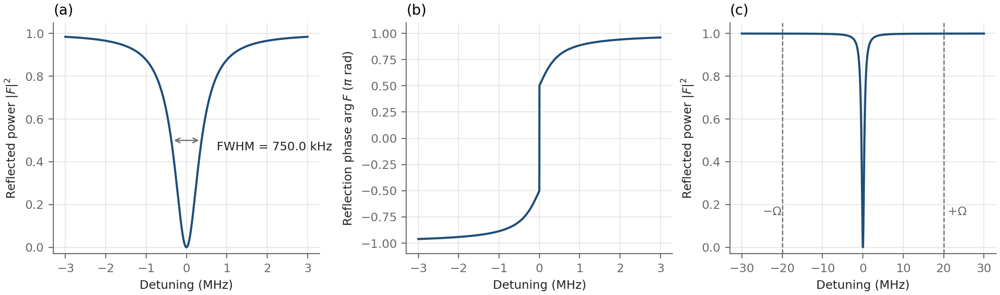
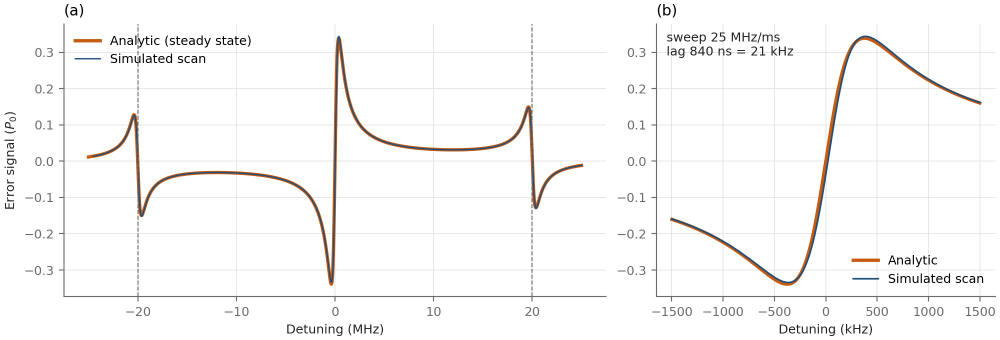
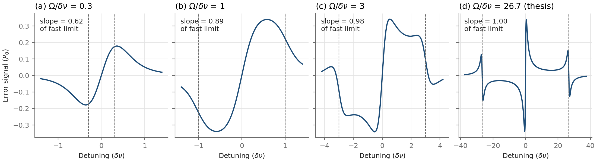
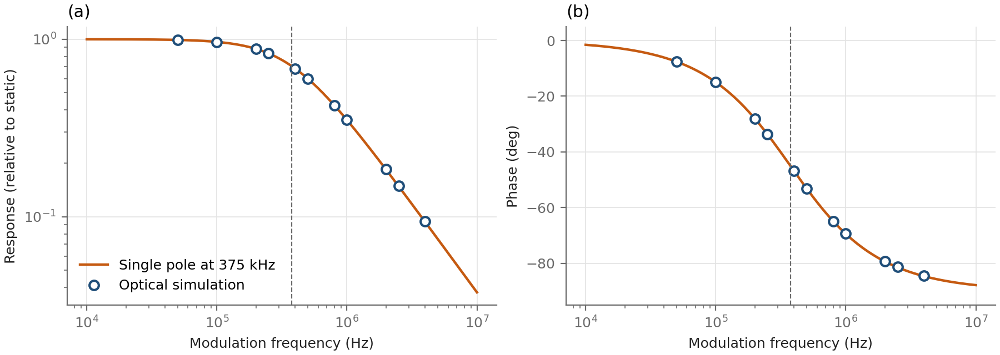
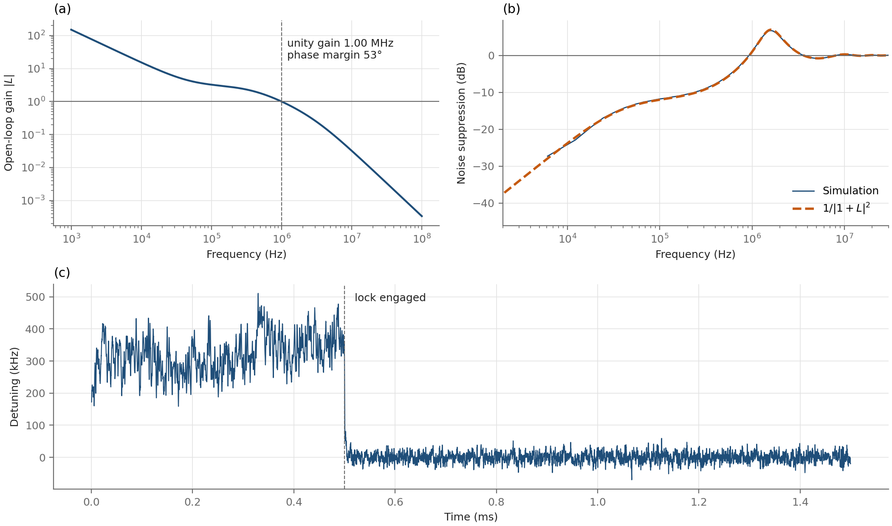
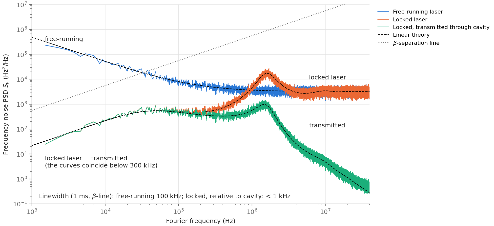
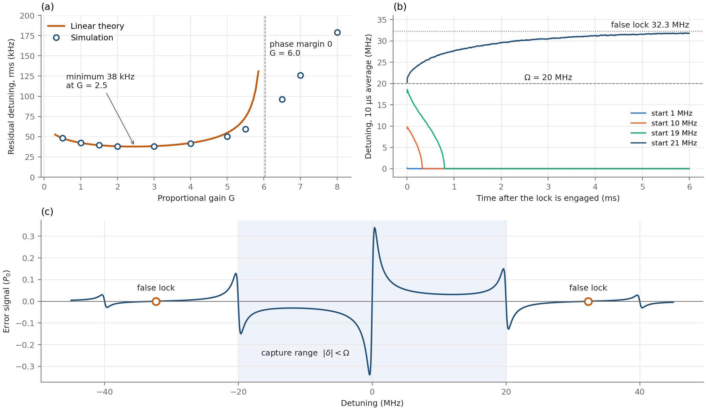
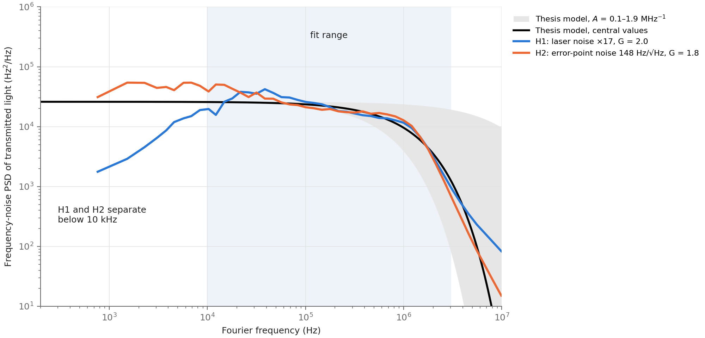

# PDH laser-lock simulation

A Python simulation of a Pound–Drever–Hall (PDH) lock of an external-cavity diode laser to a Fabry–Pérot reference cavity, built from the parameters of a working Rydberg-atom experiment and compared with the noise measured there.

**Summary of results**

- A round-trip simulation of the cavity field reproduces the analytic PDH error signal to 10⁻¹², and shows that the cavity responds to laser frequency noise as a single pole at its half-width (375 kHz) to within 0.1 % up to 1 MHz.
- A closed-loop model built on this result reproduces the analytic noise suppression 1/|1 + L|² and the servo bump, acquires lock from any detuning within the modulation frequency (±20 MHz), and locks falsely at 32.3 MHz from beyond it.
- The residual noise is lowest at a proportional gain of 2.5, well below the instability at 6.0, because additional gain enlarges the servo bump faster than it reduces the low-frequency noise.
- The measured frequency noise of the experiment's cavity-transmitted light implies a residual detuning of about 160 kHz rms, 45 % of the cavity half-width. Fits of the full nonlinear simulation to this spectrum place the unity-gain frequency at 560–620 kHz, and show that the measured level is consistent either with a laser 17 times noisier than assumed or with technical noise of about 150 Hz/√Hz at the error-signal point. The two explanations predict spectra that differ by a factor of 18 at 1 kHz, which identifies the measurement that would distinguish them.

## Status

| Step | Content | State |
|---|---|---|
| 1 | Cavity reflection model and linewidth check | done |
| 2 | PDH error signal, analytic and time-domain | done |
| 3 | Closed loop: noise model, actuator, PI controller | done |
| 4 | Noise spectra, limits of the lock, comparison with measurement | done |

## Reference cavity

| Quantity | Value | Source |
|---|---|---|
| Free spectral range | 1.5 GHz | experiment |
| Finesse | 2000 | experiment |
| Linewidth (FWHM) | 750 kHz | FSR / finesse |
| Mirror reflectivity R | 0.99843 | from finesse |
| Photon lifetime | 212 ns | 1 / (2π · linewidth) |
| Field time constant | 424 ns | 1 / (π · linewidth) |
| PDH modulation frequency Ω | 20 MHz | experiment |
| Modulation depth β | 1.08 rad | **assumed**: maximises J₀J₁ |

The modulation depth of the experiment is not recorded, so β = 1.08 rad, the value that maximises the error-signal slope, is used throughout. It changes the overall size of the error signal but not its shape near resonance.

All default parameters, with the source of each, are collected in `pdh_sim/config.py`.

## Step 1: cavity response

The reflection coefficient of a lossless cavity with identical mirrors of amplitude reflectivity *r* is

F(δ) = r (e^{iφ} − 1) / (1 − r² e^{iφ}),  φ = 2πδ / FSR,

where δ is the laser detuning from resonance (Black, Am. J. Phys. 69, 79 (2001)). The mirror reflectivity is obtained by inverting the finesse definition F = π√R / (1 − R).



**(a)** The reflected power vanishes on resonance because identical lossless mirrors make the cavity impedance matched. The width of the dip, measured numerically without assuming a line shape, is 750.0 kHz, which agrees with FSR / finesse. **(b)** The reflection phase changes by 2π across the resonance. Because |F| passes through zero at δ = 0, the phase jumps by π there, and the remaining π accumulates over roughly one linewidth on either side. The PDH technique converts this phase excursion into an error signal. **(c)** At the modulation sideband frequencies ±Ω the cavity reflects more than 99.9% of the power. Since Ω is about 27 linewidths, the lock operates in the fast-modulation regime, where the sidebands act as a fixed phase reference for the carrier.

## Step 2: PDH error signal

### Analytic calculation

The phase-modulated laser field is a comb of sidebands at δ + nΩ with amplitudes Jₙ(β), and sideband n is reflected with amplitude aₙ = Jₙ(β) F(δ + nΩ). The reflected power therefore oscillates at Ω with complex amplitude c₁ = Σₙ aₙ₊₁ aₙ*. Mixing the photodiode signal with a local oscillator cos(Ωt + θ) and averaging gives the error signal

ε(δ) = Re[c₁ e^{iθ}].

Keeping only the carrier and the first-order sidebands reproduces the expression of Black (2001). The code keeps all orders, so that the analytic result can be compared with the simulation at the level of numerical precision. Because F(−δ) = F(δ)*, c₁ is an odd function of δ, and the error signal vanishes on resonance for every demodulation phase θ.

### Time-domain simulation

The simulation advances the intracavity field one round trip (1/FSR = 0.67 ns) at a time,

a_k = t E_in,k + r² a_{k−1},   E_ref,k = −r E_in,k + t r a_{k−1}.

Light returns to the input mirror exactly one round trip later, so this recursion is exact for any input sampled at the round-trip interval, including a chirped or phase-modulated laser. A modulation period at 20 MHz spans 75 steps. The photodiode power |E_ref|² is multiplied by the local oscillator and passed through a fourth-order Butterworth low-pass filter, as in the experiment's electronics.

The simulation and the analytic formula share no code apart from the cavity parameters. At fixed detunings, where the mixer output is averaged over whole modulation periods after the cavity has settled, they agree to 10⁻⁹ of the incident power.



**(a)** A simulated scan at 25 MHz/ms overlaid on the analytic error signal, showing the central feature and the two sideband features at ±Ω = ±20 MHz. **(b)** Near resonance the simulated trace lags the analytic curve. The lag is the sum of two delays of nearly equal size: the group delay of the 1 MHz low-pass filter (416 ns), and the time constant with which the intracavity field follows the laser, 1/(π · linewidth) = 424 ns. At this sweep rate the combined 840 ns corresponds to 21 kHz of detuning. Halving the sweep rate halves the deviation, and shifting the analytic curve by the combined lag removes 80 % of it; the remainder arises because the cavity delay depends on detuning and is largest on resonance. The cavity time constant reappears in Step 3 as a low-pass filter inside the feedback loop, with its corner at the half-width, 375 kHz.

### Slow and fast modulation



For each ratio Ω/δν the demodulation phase is chosen to maximise the slope at resonance. When the modulation is slow compared with the linewidth, the sidebands are partially transmitted along with the carrier, the error signal is broad, and its slope falls below the fast-modulation limit 4J₀J₁/δν (0.62 of the limit at Ω/δν = 0.3). In the fast-modulation regime the sidebands are fully reflected and serve as a fixed phase reference, and the slope reaches the limit. For the experiment, Ω/δν = 27, the slope equals the limit to within 0.1 %, and the optimal demodulation phase differs from exact quadrature by δν/(2Ω) = 0.019 rad, which is the small phase the sidebands acquire at ±Ω.

## Step 3: closing the loop

### Reduced cavity model

Stepping the optical field every 0.67 ns is too slow for milliseconds of locked operation. Inside the loop the cavity is therefore replaced by a single-pole low-pass filter with its corner at the half-width, δν/2 = 375 kHz, followed by the static error curve of Step 2. The static curve is divided by its slope at resonance, so that the error is expressed in hertz and equals the detuning for small excursions; beyond the central slope the full curve is kept, which allows the loop to lose lock.

This replacement was checked against the full optical simulation. The laser frequency was modulated sinusoidally at frequencies from 50 kHz to 4 MHz, and the error signal was demodulated at the modulation frequency.



The optical simulation (markers) follows the single pole (line) to within 0.1 % up to 1 MHz. At 4 MHz, a fifth of the PDH modulation frequency, the deviation grows to 1 %, as corrections of order f/Ω become visible. Physically, the cavity stores light for a time 1/(πδν) = 424 ns, so the reflected carrier averages the laser phase over that time, and frequency fluctuations faster than the half-width are converted into an error signal with reduced amplitude and a phase lag approaching 90°.

### Laser noise model

The free-running frequency noise is modelled as white plus flicker noise, S_ν(f) = h₀ + h₁/f. The manufacturer quotes a typical linewidth below 100 kHz without stating an averaging time, and the noise of the laser in the experiment has not been measured, so both terms are assumptions:

| Quantity | Value | Basis |
|---|---|---|
| Intrinsic (Lorentzian) linewidth πh₀ | 10 kHz | **assumed** |
| Flicker coefficient h₁ | 4.9 × 10⁸ Hz² | **assumed**: total linewidth 100 kHz over 1 ms |

The total linewidth is evaluated with the β-separation-line method of Di Domenico *et al.* (Appl. Opt. 49, 4801 (2010)). Time series with this spectrum are generated by shaping Gaussian noise in the Fourier domain.

### Loop

The loop consists of the cavity filter, the error curve, a fixed delay, a proportional–integral (PI) controller and the diode-current actuator:

L(f) = G (1 + f_int / if) · 1/(1 + if/f_c) · 1/(1 + if/f_act) · e^{−2πifτ}.

| Quantity | Value | Basis |
|---|---|---|
| Cavity corner f_c | 375 kHz | δν/2 |
| Actuator bandwidth f_act | 3 MHz | B1047 headboard, MOGLabs manual |
| Loop delay τ | 100 ns | 40 ns headboard (manual) + 60 ns **assumed** for servo and cables |
| Proportional gain G | 3 | chosen |
| Integrator corner f_int | 50 kHz | chosen |

Above the cavity corner the cavity itself acts as an integrator, so the gain falls as 1/f and crosses unity at about G·f_c ≈ 1 MHz, beyond the cavity linewidth. The phase margin there is 53°.



**(a)** Open-loop gain. **(b)** The suppression of laser frequency noise measured in the time-domain simulation, with the full PDH error curve and the noise model above, agrees with 1/|1+L|² across the whole band. Below 100 kHz the noise is reduced by 10 to 30 dB. Near 1.6 MHz the feedback amplifies the noise by 7 dB (the servo bump), because the loop phase there approaches −180°; above a few megahertz the loop has no effect. **(c)** The laser starts 300 kHz from resonance; when the loop is engaged it is pulled onto resonance within a few microseconds and remains there. The locked mean detuning is below 1 kHz.

The residual detuning of the locked laser seen through the cavity is 38 kHz rms. Most of it is white frequency noise above the loop bandwidth, which feedback cannot remove; below 100 kHz the lock reduces the fluctuations ninefold. The residual stays well inside the central slope of the error signal, whose turning points lie at ±375 kHz. At this level the curvature of the error signal lowers the effective loop gain by a few per cent; with a noisier laser it would eventually cause loss of lock, which Step 4 examines.

## Step 4: performance, limits and comparison with measurement

### Noise spectra and linewidth



The spectra of the free-running laser, the locked laser and the light transmitted through the cavity are shown in absolute units. In each case the time-domain simulation (coloured) follows linear theory (dashed), including the servo bump near 1.6 MHz and, for the transmitted light, the additional roll-off above the cavity half-width. The linewidth is estimated with the β-separation line: only noise lying above the line 8 ln2 f/π² broadens the laser line, and the FWHM is √(8 ln2 · A), where A is the area of the spectrum above the line. The free-running laser has a linewidth of 100 kHz over 1 ms, as assumed. The spectrum of the locked laser lies below the β-line at every frequency, so its line consists of a narrow carrier on a broad, low pedestal, and its width relative to the cavity is below 1 kHz, set by the observation time. Because the simulated cavity is a perfect reference, this width excludes the frequency noise of the cavity itself.

### Limits of the lock



**(a) Gain.** As the proportional gain G increases, the residual detuning first falls, reaches a minimum of 38 kHz rms at G = 2.5, and then rises again. The rise occurs because additional gain moves the unity-gain frequency towards the region where the delay and the actuator have consumed the phase margin, so that the servo bump grows faster than the low-frequency suppression improves. The phase margin reaches zero at G = 6.0. Beyond this value linear theory no longer applies; in the simulation the loop oscillates, and the oscillation is limited only by the saturation of the error signal.

**(b, c) Capture range.** Between the central slope and the sideband features at ±Ω the error signal is small but has the sign required to pull the laser towards resonance, and the integrator accumulates it. The lock is therefore acquired from any initial detuning below Ω = 20 MHz, in 9 µs from 1 MHz and in about 0.8 ms from 19 MHz. Beyond Ω the sign reverses, and the laser is driven away from resonance until it reaches the next zero crossing with the stabilising slope, at 32.3 MHz. This false lock point lies between Ω and 2Ω, where the beat of the first- and second-order sidebands produces additional structure in the error signal.

**Noise tolerance.** Increasing the intrinsic linewidth of the laser from 10 kHz to 1 MHz raises the residual detuning in proportion to the square root of the white-noise level, in agreement with linear theory to within 3 %. Within the model the lock does not break even at a 10 MHz intrinsic linewidth, because excursions beyond the central slope remain within the ±Ω capture range. At such noise levels the laser frequency changes by megahertz faster than the cavity responds, which lies outside the small-signal regime in which the reduced cavity model was verified (Fig. 4), so no loss-of-lock threshold is quoted.

### Comparison with the measured noise of the experiment

The thesis describes the frequency noise of the cavity-transmitted 780 nm light by S(f) = h₀ e^(−Af), with h₀ = 0.026(5) MHz and A = 1.0(9) MHz⁻¹. The parameters are obtained from the noise spectrum of the transmitted light recorded on a photodiode, and independently from a fit of the interference visibility of the stored excitation as a function of storage time. A photodiode on the transmitted light responds to the laser frequency relative to the cavity resonance, after the cavity filter, which is the quantity `delta_cav` in the simulation. The β-line linewidth of this spectrum is 78 kHz, which reproduces the linewidth quoted in the thesis.

With the assumed laser noise and the default loop, the simulation predicts a transmitted-light spectrum 15 to 60 times below the measured one. Two hypotheses for the additional noise are considered:

- **H1.** The free-running laser is noisier than assumed; its spectrum is scaled by a factor k.
- **H2.** White noise S_e enters at the error-signal point, for example from the photodetector and amplifiers or from residual amplitude modulation. The loop cannot distinguish such noise from a frequency error, so it writes it onto the laser with the transfer function L/(1 + L), which is close to unity wherever the loop has gain.



Integrating the measured spectrum gives a residual detuning of √(h₀/A) ≈ 160 kHz rms, about 45 % of the cavity half-width. At this amplitude the curvature of the error signal reduces the effective loop gain and raises the low-frequency noise by up to a factor of three relative to linear theory. Each hypothesis is therefore fitted over 10 kHz–3 MHz in two stages, first with linear theory and then with the full nonlinear time-domain simulation, with the loop gain as a second free parameter.

| | H1: noisier laser | H2: error-point noise |
|---|---|---|
| Fitted noise | k = 17 | S_e^{1/2} = 148 Hz/√Hz |
| Loop gain G | 2.0 | 1.8 |
| Unity-gain frequency, phase margin | 620 kHz, 82° | 560 kHz, 88° |
| rms misfit | factor 1.18 | factor 1.23 |

Both hypotheses reproduce the measured spectrum within the fitted range equally well, and both require a loop with a unity-gain frequency near 600 kHz and a large phase margin, which accounts for the absence of a pronounced servo bump in the measurement. They imply different physics. Under H1 the free-running laser would have a linewidth of about 535 kHz over 1 ms, more than five times the manufacturer's typical value. Under H2 the error-point noise would exceed the shot-noise limit of the PDH signal [Black 2001; 0.003 Hz/√Hz for 1 mW of carrier power and 0.03 Hz/√Hz for 10 µW] by more than three orders of magnitude, so it would be technical in origin.

The two hypotheses make different predictions below 10 kHz. Laser noise is suppressed there increasingly strongly by the integrator, so under H1 the spectrum of the transmitted light falls towards low frequencies. Error-point noise is not suppressed, so under H2 the spectrum remains flat. At 1 kHz the predictions differ by a factor of 18. A measurement of the transmitted-light spectrum between 1 and 10 kHz would therefore distinguish them; a comparison of the in-loop error signal with an out-of-loop measurement would provide an independent test.

**Limitations.** The simulation treats the cavity as a perfect frequency reference. Fluctuations of the cavity length would not appear on a photodiode that detects the transmitted light, since the laser follows the cavity within the loop bandwidth, but they would appear in a measurement with the atoms. The noise floor of the photodiode measurement itself is not modelled, and A is poorly constrained: repeating the linear-theory fit with A = 0.5 and 2 MHz⁻¹ instead of 1 MHz⁻¹ moves the fitted unity-gain frequency to about 660 and 40 kHz, respectively.

## Running

The code needs numpy, scipy and matplotlib, all of which are included in Anaconda.

**In Spyder.** Unzip the folder, open `run_checks.py` and press F5. Each check prints PASS or FAIL with a one-line description. To regenerate a figure, open the corresponding script in `scripts/` and press F5; the figure appears in the Plots pane and is saved to `figures/`. Most figures take a few seconds; Figure 2 takes about 15 s, Figure 7 about 20 s, and Figure 8, which fits the full simulation to the measured spectrum, about 1–2 minutes.

**From a terminal.** The same checks also run under pytest:

```
pip install -r requirements.txt
python run_checks.py      # or: pytest
python scripts/fig1_cavity_response.py
python scripts/fig2_error_signal.py
python scripts/fig3_modulation_regimes.py
python scripts/fig4_cavity_fm_response.py
python scripts/fig5_loop.py
python scripts/fig6_spectra.py
python scripts/fig7_lock_limits.py
python scripts/fig8_thesis_comparison.py
```
